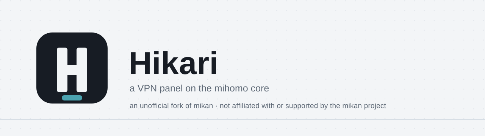
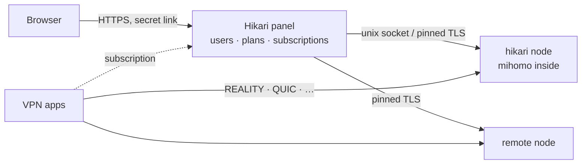

<div align="center">

<picture>
  <source media="(prefers-color-scheme: dark)" srcset=".github/assets/banner-en-dark.svg">
  
</picture>

<br>

**[mihomo](https://github.com/MetaCubeX/mihomo) çekirdeği üzerinde hızlı ve güzel bir VPN paneli: tek komutla kurulur, başında beklemek gerekmez.**

[](https://github.com/ShelbyHell/Hikari/releases)
[](https://github.com/ShelbyHell/Hikari/pkgs/container/hikari)
[](LICENSE)
[](https://github.com/MetaCubeX/mihomo)

[English](README.md) · [Русский](README.ru.md) · [简体中文](README.zh-CN.md) · [فارسی](README.fa.md) · **Türkçe** · [Español](README.es.md)

</div>

---

> [!IMPORTANT]
> **Resmî olmayan bir fork.** Hikari, mikan projesiyle ilişkili değildir ve onun tarafından desteklenmez. Destek yalnızca fork yazarından gelir ([ShelbyHell/Hikari](https://github.com/ShelbyHell/Hikari)). Orijinal mikan: [Miroshka000/mikan](https://github.com/Miroshka000/mikan).

## Kurulum

Yeni bir Ubuntu 22.04+ veya Debian 12+ sunucuda (amd64 veya arm64):

```bash
curl -fsSL https://github.com/ShelbyHell/Hikari/releases/latest/download/install.sh | sudo bash
```

Kurulum betiği panel dilini ve isteğe bağlı bir alan adını sorar, alan adının sunucuyu gösterdiğini kontrol eder, gerekirse Docker'ı kurar, sunucunuzun yakınında REALITY kamuflaj siteleri seçer ve yönetici bağlantınızı yazdırır. Yönetim menüsü için `hikari` komutunu istediğiniz zaman yeniden çalıştırabilirsiniz.

Mevcut bir panele düğüm eklemek için: panelin **Düğümler** sayfası (veya `hikari node add`) anahtarıyla birlikte komutu verir:

```bash
curl -fsSL https://github.com/ShelbyHell/Hikari/releases/latest/download/install.sh | sudo bash -s -- --join KEY
```

Soru sormadan, betikler için: `… | sudo bash -s -- --yes --lang en --domain vpn.example.com --email you@example.com` (tüm bayraklar: `hikari install --help`).

## Neden Hikari

<table>
<tr>
<td width="50%" valign="top">

### 🛡️ Engellemeden kendi başına kurtulur
Hikari, gerçek istemcilerin her protokole hâlâ ulaşıp ulaşamadığını izler. Bir port yolda engellendiğinde protokolü boş bir HTTPS portuna taşır; bir REALITY kamuflaj sitesi çalışmayı bırakırsa sunucunuzun yakınında yenisini seçer.

</td>
<td width="50%" valign="top">

### 📱 Her uygulama kullanabildiğini alır
Abonelikler uygulamayı tanır (Happ, v2RayTun, Koala Clash, SlothClash, Clash Verge, FlClash, ClashFest, Hiddify, Shadowrocket ve diğerleri) ve ona yalnızca gerçekten desteklediği protokolleri verir. “Bende çalışmıyor” dönemi bitti.

</td>
</tr>
<tr>
<td valign="top">

### 📊 Bayt hassasiyetinde sayım
mihomo bir kütüphane olarak gömülüdür, bu yüzden trafik her bağlantıda kullanıcı bazında sayılır, örneklenmez. Süreye ve gigabayta göre planlar, faturalama günleri, cihaz sınırları ve anahtar paylaşımına karşı cihaz bağlama.

</td>
<td valign="top">

### 🤖 Telegram botu ve Mini App dahili
Aboneler planlarını, cihazlarını ve bağlantı rehberlerini panelde kurduğunuz bir botta kontrol eder, abonelik sayfasını Telegram Mini App olarak açar ve süre dolmadan önce bildirim alır. Satın alma ve yenileme de yapabilirler: Telegram Stars, YooKassa üzerinden kartlar ve SBP veya CryptoBot ile kripto. Bağlantıyı panel kendisi verir. Toplu mesajlar Telegram'ın sınırlarına uyar.

</td>
</tr>
<tr>
<td valign="top">

### 🪶 Tüy kadar hafif
Go ve PostgreSQL, üç küçük konteyner. İstemcileri olan çalışan bir sunucuda: panel için **~14 MB RAM**, veritabanı için **~50 MB**, VPN çekirdeği için **~40 MB**.

</td>
<td valign="top">

### 🔒 Varsayılan olarak kilitli
Rastgele bir portta gizli yönetici bağlantısı, Let's Encrypt ile HTTPS (çıplak IP için bile), argon2id, TOTP ile iki adımlı doğrulama, CSRF koruması, sıkı CSP, denetim günlüğü. Konteynerler root olmadan, salt okunur çalışır ve tüm capabilities yetkileri düşürülmüştür.

</td>
</tr>
<tr>
<td valign="top">

### 🌐 WARP ve sunucu kaskadları
Her düğümün kendi WARP'ı olabilir: tek tıkla veya WireGuard yapılandırmanızdan kaydedilir. Protokoller panelin başka bir düğümü üzerinden de çıkabilir (istemci → düğüm A → düğüm B → internet). Seçilen protokoller, alan adları ve ağlar bu yolları kullanır, geri kalan her şey doğrudan gider.

</td>
<td valign="top">

### 🧩 Entegrasyonlar için API ve anahtarlar
Doğrudan panelde belgelenmiş bir REST API. Botlar, faturalama ve izleme için salt okunur veya tam erişimli anahtarlar.

</td>
</tr>
</table>

## Promosyon kodları

Yöneticiler indirim kodları ile bonus gün veya trafik kodları oluşturabilir. Aboneler
kodları Telegram Mini App'te kullanır, uygulama kullanım geçmişini de gösterir. Bonus
trafik ana bakiyeye ya da seçilen bir havuza eklenebilir. İndirimli faturalar yalnızca
iade destekleyen ödeme yöntemleriyle ödenebilir: Telegram Stars ve iade desteği bildiren
adaptörler. Böylece sağlayıcı ödemeyi onaylamadan promosyon rezervasyonunun süresi dolarsa
Hikari ödemeyi iade edebilir.

## Destek erişimi

Yardıma ihtiyacın olduğunda geçici erişimi kendin açarsın: Ayarlar → Destek, 2, 6 veya 24 saatliğine, «görüntüleme», «değiştirme» veya «terminal» seviyesinde. Bu düğme olmadan Hikari geliştiricileri dahil kimse panele giremez: projenin sunucularına kalıcı erişimi yoktur ve panel kendiliğinden hiçbir yere bağlanmaz. Operatörün her işlemi denetim günlüğüne yazılır, erişim tek düğmeyle geri alınır, terminal parolan ve 2FA ile açılır ve kaydedilir. Özelliği tamamen kapatmak için aynı karttaki anahtarı kullan veya sunucuda `hikari support-access off` çalıştır. Ücretli destek kuralları: [sitede](https://shelbyhell.github.io/Hikari/support/paid/).

## Protokoller

On yedi protokol, her biri sizin için üretilmiş anahtarlarla hazır bir ön ayar. Abonelik her uygulamaya yalnızca çalıştırabildiğini verir:

| Protokol | Clash uygulamaları<br><sub>mihomo çekirdeği</sub> | Xray uygulamaları<br><sub>Happ, v2RayTun</sub> | sing-box uygulamaları<br><sub>Hiddify, Karing</sub> |
|---|:---:|:---:|:---:|
| VLESS · REALITY · Vision | ✅ | ✅ | ✅ |
| VLESS · REALITY · XHTTP | ✅ | ✅ | — |
| VLESS · REALITY · gRPC | ✅ | ✅ | ✅ |
| VLESS PQ (kuantum sonrası şifreleme) | ✅ | ✅ | — |
| Trojan · REALITY | ✅ | ✅ | ✅ |
| VLESS · TLS · XHTTP | ✅ | ✅ | — |
| VLESS · TLS · Vision | ✅ | ✅ | ✅ |
| Hysteria2 | ✅ | ✅ | ✅ |
| TUIC v5 | ✅ | — | ✅ |
| AnyTLS | ✅ | — | ✅ |
| TrustTunnel | ✅ | — | — |
| ShadowQUIC | ✅ | — | — |
| Mieru | ✅ | — | — |
| Shadowsocks-2022 ¹ | ✅ | ✅ | ✅ |
| Sudoku ¹ | ✅ | — | — |
| Snell ¹ | ✅ | — | — |
| VMess (özel yapılandırma) | ✅ | ✅ | ✅ |

<sub>¹ mihomo'da tüm kullanıcılar için tek anahtar vardır: bu protokollerde kullanıcı bazında sayım ve sınır yoktur. Yeni protokoller Clash uygulamalarına yalnızca çekirdekleri yeterince yeniyse gönderilir.</sub>

## Nasıl çalışır



Panel ve düğüm, aynı imajdan çalışan iki işlemdir. Paneli güncelleyin veya yeniden başlatın, VPN çalışmaya devam eder. **Düğümler** sayfasından bir katılma anahtarıyla uzak düğümler ekleyin.

## Sunucuyu yönetme

Menü için `hikari` komutunu çalıştırın veya komutları doğrudan kullanın:

| Komut | Ne yapar |
|---|---|
| `hikari status` | konteynerler, sürümler, sağlık durumu, mevcut güncelleme |
| `hikari logs [panel\|node]` | canlı günlükler |
| `hikari url` | yönetici bağlantısı |
| `hikari reset-password` · `reset-path` · `disable-2fa` | erişimi geri kazanma |
| `hikari update` | şimdi güncelle (önce yedek, otomatik geri alma) |
| `hikari backup` · `restore FILE` | yedekler `/opt/mikan/backups` içinde |
| `hikari node …` · `hikari inbound …` | düğümler ve protokoller |
| `hikari targets scan` · `apply` | sunucunun yakınındaki REALITY kamuflaj siteleri |
| `hikari join KEY` | düğümde: panelden yeni bir anahtar al |
| `hikari restart` | konteynerleri yeniden başlat |
| `hikari doctor` | sunucuyu denetle: Docker, portlar, güvenlik duvarı, saat, DNS, disk |
| `hikari support KOD` | panel erişilemezken tanılamayı destek talebine gönder |
| `hikari support-access on\|off` | bu sunucuda destek erişimine izin ver veya yasakla |
| `hikari uninstall` | durdur ve komutu kaldır, veriyi koru |

## Güncellemeler

Panel günde bir kez yeni sürüm olup olmadığına bakar ve nelerin değiştiğini gösterir. Ayarlarda **otomatik güncellemeyi** açın veya **Güncelle**'ye basın: sunucudaki güncelleyici imajı GitHub Packages'tan çeker, yedek alır, veritabanını taşır, yeniden başlatır ve yeni sürüm sağlıklı şekilde ayağa kalkmazsa geri alır. Her sürüm manifestosu imzalıdır.

0.4.4 veya daha eskisindeyseniz önce 0.4.5'e güncelleyin. 0.5'e ve PostgreSQL'e geçiş de ardından Güncelle düğmesiyle gelir. 0.4.5'i atladıysanız yukarıdaki kurulum komutu mevcut bir sunucuyu günceller.

## Kaynaktan derleme

```bash
docker buildx build -t Hikari:dev .            # panel + node image
cd web && pnpm install && pnpm dev            # admin UI with hot reload
MIKAN_TEST_DATABASE_URL=postgres://… go test ./...   # Go 1.27, a test PostgreSQL 18 and pg_dump
cd installer && cargo test                    # the installer (Rust)
```

Geliştirme `dev` dalında yapılır. `main` dalına açılan çekme istekleri derlenir ve test edilir, sürümler etiketlerden yayımlanır.

## ⛔ Fork'lar ve üçüncü taraf derlemeler

> [!CAUTION]
> **Resmî mikan yalnızca burada:** `Miroshka000/mikan` deposu, `ghcr.io/miroshka000/mikan` imajı ve mikan anahtarıyla imzalanmış sürümler. Resmî eklentiler yalnızca `getmikan/marketplace` kataloğundan gelir; topluluk kaydı `getmikan/marketplace-community`, mikan'ın incelemediği ve sorumluluğunu almadığı üçüncü taraf eklentileri listeler. Geri kalan her şey, adı ne olursa olsun, mikan değildir.
>
> **mikan projesi, her fork'u ve başka kaynaklardan gelen her derlemeyi potansiyel olarak güvensiz kabul eder.**
>
> **Resmî derlemeler doğrulanabilir.** Her sürüm bu deponun açık kodundan otomatik olarak derlenir ve imzalanır; panel ve kurulum aracı yalnızca bu imzayı taşıyan güncellemeleri kabul eder. Başkasının derlemesinin neyden yapıldığını yalnızca yazarı bilir.
>
> **Fork'lar güncellemelerimizi almaz.** Bir fork, sürümlerini mikan anahtarıyla imzalayamaz; bu yüzden hata ve güvenlik açığı düzeltmeleri, yazarı onları taşımadıkça ona ulaşmaz.
>
> **Fork'ları desteklemiyoruz.** Onları incelemiyoruz ve içlerindeki hatalardan, güvenlik açıklarından veya veri kaybından sorumlu değiliz. Başkalarının derlemeleriyle ilgili sorular sohbette ve issue'larda ele alınmaz.
>
> **Ad lisansın parçası değildir.** GPL v3 kodu kapsar, mikan adını ve logosunu değil (GPL v3 bölüm 7, bkz. [NOTICE.md](NOTICE.md) ve [TRADEMARK.md](TRADEMARK.md)). Bir fork başka bir ad kullanmalı ve kendini mikan olarak tanıtmamalıdır.

## Lisans

Hikari, mikan’ın bir fork’u olarak, [GNU GPL v3](LICENSE) ve [NOTICE.md](NOTICE.md) dosyasındaki ek koşullar altında özgür yazılımdır: atıf korunur, değiştirilmiş bir sürüm orijinal gibi tanıtılmaz, ad ve logo üzerinde hak verilmez. Copyright (C) 2026 Miroshka and Mikan. İçine [mihomo](https://github.com/MetaCubeX/mihomo) (GPL-3.0) gömülüdür ve [3x-ui](https://github.com/MHSanaei/3x-ui) (GPL-3.0) kodunun bazı bölümleri uyarlanmıştır. Yazı tipleri: Unbounded, Onest, JetBrains Mono (SIL OFL 1.1).

<div align="center">
<sub>Hikari — mikan’ın resmî olmayan bir fork’u</sub>
</div>
